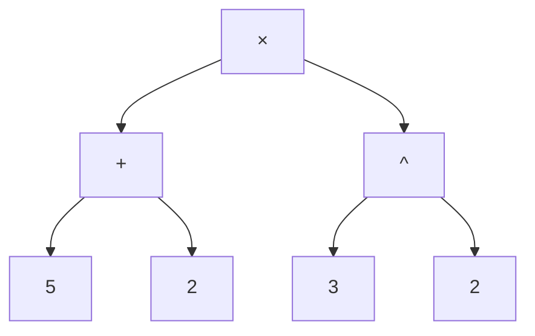
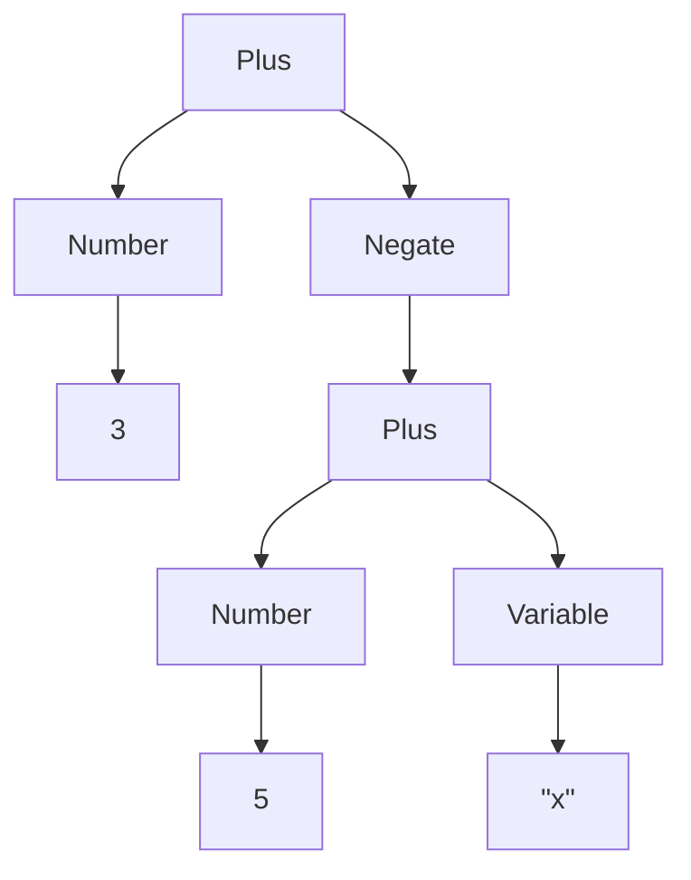
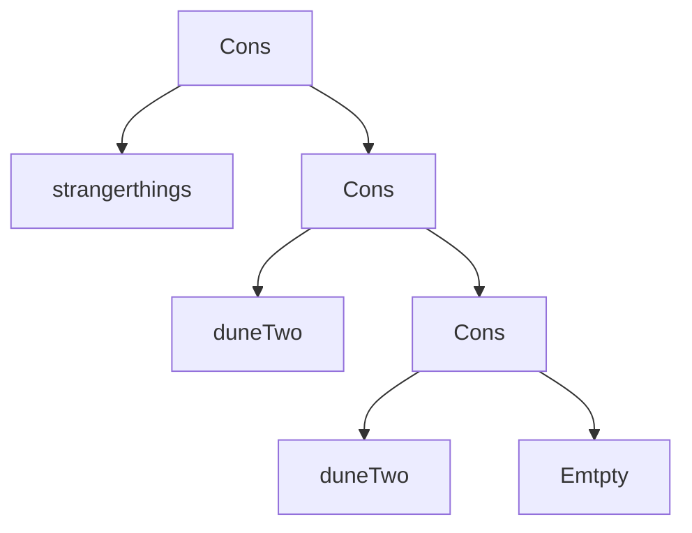

Woche 2 – Bäume und Datentypen

## Daten, Repräsentation und Bäume

- Dieselben abstrakten Dinge können **verschieden repräsentiert** werden (Zahl 11: römisch XI, dezimal 11, binär 1011, deutsch „elf", Strichliste). **Algorithmen hängen von der Repräsentation ab** (Addition geht dezimal/binär gut, römisch/deutsch schlecht).
- Repräsentation wird **anwendungsabhängig** gewählt (Person: Foto / soziales Netz / Marketing-Daten / Stammbaum).
- In FP sind Daten oft **Bäume**:
    - genau **eine Wurzel**, beliebig viele Teilbäume; Knoten ohne Teilbäume = **Blätter**
    - Knoten/Kanten können beschriftet sein; Bäume wachsen in der Informatik **nach unten**

### Ausdrücke = Bäume

`(5 + 2) × 3^2` als Baum:



- **Parsen** = Text → Baum. **Präzedenzen** (`^` vor `×` vor `+`) und Klammern sind nur fürs Parsen nötig, im Baum kommen sie nicht mehr vor.
- Taschenrechner: Eingabe parsen → Baum **von unten nach oben** (Blätter → Wurzel) auswerten.

### Programme = Bäume

- **Abstrakter Syntax Baum (AST):** Kommentare und Klammern verschwinden.
- Weitere Baum-Daten: Compiler (AST → Binärcode), HTML, XML, Dateisysteme.

---

## Typen

- Typ = **Menge von Werten** → beschreibt Definitions- und Wertebereich von Funktionen
- Haskell-Typen: `Integer` (ℤ, beliebig genau), `Double` (ℝ), `String`, `Char`, `Bool`, …

### Typ-Annotationen

```haskell
7 :: Integer
7 :: Double
'c' :: Char
```

Fehler: `7 :: String`, `0.75 :: Integer`, `'c' :: String`, `(7 :: Integer) :: Double`

> [!note] Wichtig In Haskell sind `Integer` und `Double` **unvergleichbar** (kein ℕ ⊆ ℤ ⊆ ℝ). Zwischen Zahlentypen ist oft **explizite Konvertierung** nötig. Manche Ausdrücke haben mehrere mögliche Typen (`7`, `7 + 5`) – mit Annotation ist der Typ **fixiert**.

### Typen von Funktionen

```haskell
(/)  :: Double -> Double -> Double
(+)  :: Integer -> Integer -> Integer   -- (+) hat mehrere Typen
head :: String -> Char                  -- (hier vereinfacht dargestellt)
```

- Typen sind **keine** beliebigen Mengen (z. B. kein `Double \ {0}`).
- Typcheck bei `expr1 / expr2`: beide Argumente müssen `Double` sein → Gesamtausdruck ist `Double`.
- ✅ `5 + 3 / 2` · ❌ `5 + '3'`, `5.2 + 0.8 :: Integer`

### Statische Typprüfung

- Typen werden **vor** der Auswertung geprüft (beim Laden des Skripts und bei jeder REPL-Eingabe)
- Für jede Definition `f x … = expr`: linke und rechte Seite müssen denselben Typ haben
- Ausdrücke ändern ihren Typ während der Auswertung nicht
- Milner 1978: _„Well typed programs cannot go wrong."_

### Eingebaute Typen

|Typ|Beschreibung|Beispiele|
|---|---|---|
|`Integer`|beliebig genaue ganze Zahlen|`-5`, `123456789012345`|
|`Int`|feste Genauigkeit (mind. −2²⁹ … 2²⁹−1)|`-100`, `999`|
|`Float` / `Double`|Gleitkomma einfach / doppelt|`-12.34`, `5.78e36`|
|`Char`|einzelnes Zeichen|`'a'`, `' '`|
|`String`|Zeichenkette|`"Die Antwort ist 42."`|
|`Bool`|Wahrheitswerte|`True`, `False`|

Escape-Sequenzen: `\t` `\n` `\"` `\'` `\\`

---

## Datentypen (`data`)

```haskell
data TName =
    CName1 type1_1 ... type1_N1
  | ...
  | CNameM typeM_1 ... typeM_NM
  deriving Show
```

- `TName`: Typname (**Großbuchstabe**)
- `CName…`: **Konstruktoren** = beschriftete Wurzeln (ebenfalls **Großbuchstabe**)
- Argumenttypen: beliebige Typen, auch `TName` selbst (**Rekursion**)
- `|` trennt Konstruktoren; `deriving Show` nötig, um Werte anzuzeigen
- Konstruktoren sind Funktionen, die **nicht ausgewertet** werden, z. B. `DMY :: Int -> Int -> Integer -> Date`

### Beispiele aus der Vorlesung

```haskell
data Date = DMY Int Int Integer            -- Tag, Monat, Jahr
  deriving Show

data Person = Person String String Bool Date  -- Vorname, Nachname, verheiratet?, Geburtstag
  deriving Show

today  = DMY 19 10 2026
myself = Person "Rene" "Thiemann" True today
```

```haskell
data Brand = Audi | BMW | Fiat | Lamborghini deriving Show   -- Aufzählung

data Vehicle =
    Car Brand Double      -- Leistung
  | Bicycle
  | Truck Int             -- Anzahl Räder (Typ garantiert NICHT Räder >= 4)
  deriving Show
```

```haskell
data Expr =                -- rekursiver Datentyp
    Number Integer
  | Variable String
  | Plus Expr Expr
  | Negate Expr
  deriving Show

-- (−(5 + x)) + 3
-- Plus (Negate (Plus (Number 5) (Variable "x"))) (Number 3)
```

```haskell
data List = Empty | Cons Integer List deriving Show
-- [1,7,9,2]  =  Cons 1 (Cons 7 (Cons 9 (Cons 2 Empty)))
```



### Baum ↔ Text: Eingabe-Regeln

Baum mit Konstruktor `C` und Teilbäumen `t1 … tN` schreibt man **`C (t1) … (tN)`**; Klammern um _atomare_ Teilbäume kann man weglassen. Dasselbe Format gilt für Funktionsanwendungen.

```haskell
Person "Rene" "Thiemann" True (DMY 19 10 2026)                        -- ✔
Person "Rene" "Thiemann" (5 > 3) (DMY 19 (length "0123456789") 2026) -- ✔
Person ("Rene", "Thiemann", True, DMY (19, 10, 2026))                 -- ✘ (Tupel statt Argumente)
Person "Rene" "Thiemann" True DMY 19 10 2026                          -- ✘ (Klammern fehlen)
```

> [!tip] Merkregel Funktionsanwendung wird **durch Leerzeichen** geschrieben, nicht mit Klammern und Kommas (`f x y`, nicht `f(x, y)`). Genau deshalb müssen zusammengesetzte Argumente geklammert werden.

---

# Aufgabe

## Übungsblatt 1 – `Template_01.hs`

```haskell
module Template_01 (gravitationalEnergy, kineticEnergy, totalEnergy, velocityByEnergy) where

important = "Keine Änderungen oberhalb dieser Zeile sind erlaubt!"

-- Aufgabe 1:

gravitationalEnergy m h = m * 10 * h

kineticEnergy m v = (1/2 * m) * v*v

totalEnergy m h v = kineticEnergy m v + gravitationalEnergy m h

velocityByEnergy m e = sqrt(2 * e / m)

totalVelocity m h v = undefined

-- Erklären Sie hier den Unterschied zwischen `gravitationalEnergy 70 3 + 1` und `gravitationalEnergy 70 (3 + 1)`:
```

**Bezug zur Vorlesung**

- Funktionsdefinitionen als Gleichungen, Namen in `camelCase` (→ Woche 1)
- `totalEnergy` baut auf den anderen Funktionen auf (Funktionsaufrufe im rechten Ausdruck)
- Typen werden hier **inferiert**, es gibt noch keine Typsignaturen

---

## Übungsblatt 2 – `Template_02.hs`

### Aufgabe 1 – Abstrakter Syntax Baum

Ausdruck: `(negate (-6) - 2) * pi * square r`

```text
*
├── Square
│   └── r
└── *
    ├── Pi
    └── -
        ├── 2
        └── negate
            └── (-6)
```

> [!question] Zum Nachprüfen `*` ist **linksassoziativ**, also `((… ) * pi) * (square r)`. Außerdem ist `negate` / `square` eine **Funktionsanwendung** auf ein Argument (`negate (-6)`), und die Klammer `(negate (-6) - 2)` wird zuerst als Subtraktion geparst. Vergleiche die Reihenfolge der Kinder mit der Präzedenz-Regel aus Woche 2.

### Aufgabe 2 – Typen bestimmen

```haskell
-- (a) 42                        -> beliebig genaue Ganzzahl
-- (b) 42 :: Integer             -> beliebig genaue Ganzzahl
-- (c) 42 :: Int                 -> Ganzzahl mit fixer Genauigkeit
-- (d) 3.14 :: Int               -> nicht typkorrekt (3.14 ist keine Ganzzahl)
-- (e) 3.14                      -> Fractional (Double oder Float) [Fractional = Typeclass]
-- (f) 'x'                       -> Char
-- (g) True                      -> Bool
-- (h) "xdfdf"                   -> String
-- (i) applyDiscountD            -> Double
-- (j) applyDiscountD 19.99 0.2  -> Double
-- (k) applyDiscountI            -> Int
-- (l) Product                   -> String Integer Double (=Product)
-- (m) Product "Notebook" 5 799.0 -> Product (String Integer Double)
```

> [!note] Hinweis zu den Notizen `42` ohne Annotation kann mehrere Typen haben (Woche 2: „manche Ausdrücke haben mehrere Typen"). Bei (i), (k), (l) lohnt sich ein Blick auf die **Aufgabenstellung**: Ist `applyDiscountD` ein Wert oder eine Funktion (`->`)? Ist `Product` der Typ oder der Konstruktor (Typ-Name vs. Konstruktor-Name)?

### Aufgabe 3 – Watchlist mit `data`

```haskell
-- 3.1 Datentypen
data Datum = Datum
    Int  -- d
    Int  -- m
    Int  -- y
    deriving (Show)

data Status
  = Ungesehen
  | Wird_geschaut Int
  | Fertig_angeschaut Datum
  deriving (Show)

data Format
  = Film Int          -- Länge in Minuten
  | Serie Int Int     -- Anzahl Staffeln, Minuten pro Episode
  deriving (Show)

data WatchItem = WatchItem
  String   -- Titel
  Integer  -- Erscheinungsjahr
  Status   -- Zuschau-Status
  Format   -- Film oder Serie
  deriving (Show)

-- 3.2 Einträge
oppenheimer :: WatchItem
oppenheimer = WatchItem "Oppenheimer" 2023 (Fertig_angeschaut (Datum 12 1 2025)) (Film 180)

strangerthings :: WatchItem
strangerthings = WatchItem "Stranger Things" 2016 (Wird_geschaut 65) (Serie 5 42)

duneTwo :: WatchItem
duneTwo = WatchItem "Dune: Part Two" 2024 Ungesehen (Film 165)

-- 3.3 eigener Listentyp (ohne eingebauten Listentyp)
data Watchlist
  = Emtpty
  | Cons WatchItem Watchlist
  deriving (Show)

-- 3.4 Beispiel-Watchlist
exampleWatchlist :: Watchlist
exampleWatchlist = Cons strangerthings $ Cons duneTwo $ Cons duneTwo Emtpty
```

**Bezug zur Vorlesung**

|Konzept|Wo in der Abgabe|
|---|---|
|Datentyp mit **einem** Konstruktor|`Datum`, `WatchItem` (wie `Date` / `Person`)|
|**Aufzählung / mehrere Konstruktoren** mit unterschiedlichen Argumenten|`Status`, `Format` (wie `Vehicle`)|
|Verwendung zuvor definierter Typen → **mehrere Baum-Ebenen**|`WatchItem` nutzt `Status` und `Format`, `Status` nutzt `Datum`|
|**Rekursiver Datentyp**|`Watchlist` (wie `List` / `Expr`)|
|Typ-Annotation `::`|`oppenheimer :: WatchItem` usw.|
|`deriving Show`|bei allen Datentypen|

**Beispiel-Baum von `exampleWatchlist`:**



---

# 🧠 Schnell-Check (Selbsttest)

1. Was unterscheidet **Syntax** von **Semantik**?
2. Wie wertet ein funktionales Programm aus – und was ist anders als bei Zuweisungen?
3. Warum ist `5 + "five"` ein Fehler, **bevor** etwas ausgewertet wird?
4. Wann braucht man bei `C t1 t2` Klammern um `t1`?
5. Was ist ein **rekursiver Datentyp**? Nenne zwei Beispiele aus der VO.
6. Wie sieht `[3, 5]` als `List` aus (Text + Baum)?
7. Warum garantiert `Truck Int` nicht, dass die Radzahl ≥ 4 ist?

---

# 📌 Cheat-Sheet

|Konzept|Syntax / Merksatz|
|---|---|
|Funktionsdefinition|`name arg1 arg2 = ausdruck`|
|Funktionsaufruf|`f x y` (nicht `f(x,y)`)|
|Kommentare|`-- Zeile` · `{- Block -}`|
|Typ-Annotation|`ausdruck :: Typ`|
|Funktionstyp|`f :: A -> B -> C`|
|Datentyp|`data T = C1 t1 t2 \| C2 \| … deriving Show`|
|Namen|Funktionen/Variablen **klein**, Typen/Konstruktoren **groß**|
|`ghci`|`:load file.hs` · `:q` · `:t ausdruck` (Typ anzeigen)|
|Auswertung|„Gleiches durch Gleiches ersetzen", Typcheck **vor** Auswertung|
