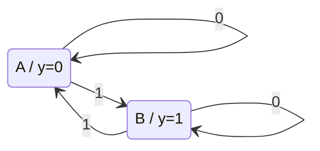
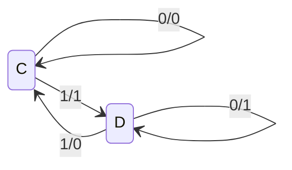

#Rechnerarchitektur #Logik
# Rechnerarchitektur – Sequenzielle Logik

> [!abstract] Kurzüberblick Kombinatorische Logik hat **kein Gedächtnis**. Durch **kontrollierte Rückkopplung** entstehen **Flipflops** (1-Bit-Speicher). Mit einem **Takt** werden daraus **synchrone Schaltwerke**, die man systematisch über **Zustandsautomaten** (Moore/Mealy) entwerfen kann.

**Gliederung der Vorlesung**

1. Vom Gatter zum Flipflop
2. Zeit und Takt
3. Schaltwerke
4. Systematischer Entwurf synchroner Schaltwerke (Fortsetzung nächster Termin)
---

## 1. Einführung & Abgrenzung

Bisher (kombinatorische Logik) galt: Die Ausgabe hängt **nur** von der aktuellen Eingabe ab. Schaltnetze werden dabei **idealisiert verzögerungsfrei** betrachtet. Ein entscheidender Mangel: **Es gibt keine Möglichkeit, Information zu speichern.** Wir brauchen also eine Methode, Zustände über die Zeit zu behalten.

![[Pasted image 20261111095846.png]]

| |Kombinatorische Logik|Sequenzielle Logik|
|---|---|---|
|Rückkopplung|keine|**kontrolliert**|
|Grundelemente|Gatter|Gatter + daraus gebaute **Flipflops**|
|Zeit|verzögerungsfrei (idealisiert)|Zeitverhalten mit konstanter **Gatterlaufzeit τ**|
|Beschreibung|Wahrheitstabelle, Boolesche Ausdrücke|Zustandstabelle, Zustandsdiagramm, Ansteuer- und Ausgabegleichungen|
|Bezeichnung|**Schalt_netz_**|**Schalt_werk_**|

> [!tip] Merkhilfe Schalt**netz** = kein Gedächtnis. Schalt**werk** = hat Gedächtnis (Zustand).

---

## 2. Vom Gatter zum Flipflop

### 2.1 Rückkopplung eines Gatterausgangs

**Rückkopplung** = der Ausgang eines Gatters wird wieder als (eigener) Eingang verwendet.

![[Sequenzielle Logik_s4.png]]

Beispiel **NOR-Gatter** mit rückgekoppeltem Ausgang ($y$ geht zurück an einen Eingang, $x$ ist der andere):

|$x(t)$|$y(t+\tau)$|$y(t+2\tau)$|$y(t+3\tau)$|
|---|---|---|---|
|0|$\overline{y(t)}$|$y(t)$|$\overline{y(t)}$|
|1|0|0|0|

- Ein Gatter braucht die Zeit **τ**, bis sich sein Ausgang an eine neue Eingabe angepasst hat. Der Zustand ändert sich daher immer in Schritten von τ.
- $x = 1$: Ausgang ist stabil 0 (NOR mit einer 1 am Eingang ergibt immer 0).
- $x = 0$: Das Gatter wirkt wie ein Inverter auf sich selbst → der Ausgang **kippt bei jedem τ** hin und her.

> [!warning] Fazit Einfache Rückkopplung eines Gatters → Ausgang **oszilliert weitgehend unkontrolliert**. Nutzlos als Speicher.

### 2.2 Kreuzweise Rückkopplung zweier Gatter

Idee: Zwei NOR-Gatter (O = oben, U = unten), jeweils der Ausgang des einen geht in den Eingang des anderen.
![[Sequenzielle Logik-s5.png]]

|$x_0$|$x_1$|$y_0(t+\tau)$|$y_1(t+\tau)$|$y_0(t+2\tau)$|$y_1(t+2\tau)$|
|---|---|---|---|---|---|
|0|0|$\overline{y_1(t)}$|$\overline{y_0(t)}$|**?**|**?**|
|0|1|$\overline{y_1(t)}$|0|1|0|
|1|0|0|$\overline{y_0(t)}$|0|1|
|1|1|0|0|0|0|

Wichtig zum Verständnis:

- **Zeilen (0,1) und (1,0):** Der Ausgang geht nach 2τ in einen **stabilen** Zustand → man kann den Zustand gezielt **setzen** bzw. **löschen**.
- **Zeile (0,0):** Die Ausgänge **behalten** ihre Werte (stabil, sofern schon ein gültiger Zustand vorliegt) → **hier steckt der Speicher!** Das „?" heißt: Der Wert hängt vom vorherigen Zustand ab.
- **Zeile (1,1):** Beide Ausgänge sind 0. Das widerspricht der Erwartung, dass $Q$ und $\overline{Q}$ Gegenteile sind. Außerdem ist unklar, in welchen Zustand die Schaltung kippt, wenn man danach auf (0,0) zurückgeht (Wettlauf der Laufzeiten) → **nicht erlaubt**.

### 2.3 RS-Flipflop

Das Ergebnis der kreuzweisen Rückkopplung ist das **RS-Flipflop** (auch „bistabile Kippstufe", engl. _latch_).

![[Sequenzielle Logik_26.png]]

- **R** = _reset_ (löschen, $Q \to 0$)
- **S** = _set_ (setzen, $Q \to 1$)
- Ausgänge: $Q$ und $\overline{Q}$
- Realisierung mit **zwei NOR-Gattern**

**Charakteristische Tabelle** ($Q'$ = Folgezustand, $Q$ = aktueller Zustand):

|R|S|$Q'$|Bedeutung|
|---|---|---|---|
|0|0|$Q$|**speichern** (Zustand halten)|
|0|1|1|**setzen**|
|1|0|0|**löschen**|
|1|1|–|**nicht erlaubt**|

> [!info] Analogie: Wippe Das Flipflop ist **bistabil** wie eine Wippe: Sie liegt auf einer Seite und bleibt dort, bis man sie von der anderen Seite herunterdrückt (S drückt auf die eine, R auf die andere Seite).

### 2.4 Flipflop aus Transistoren

**Transistor** (engl. _transfer resistor_): Strom fließt von **C** (Collector) nach **E** (Emitter) genau dann, wenn ein vernachlässigbar kleiner Steuerstrom von **B** (Basis) nach E fließt. Er arbeitet also wie ein **elektrisch gesteuerter Schalter**.

- **Gatter aus Transistoren:** z. B. ein AND-Gatter aus zwei in Reihe geschalteten Transistoren $T_1$, $T_2$. Nur wenn **beide** Basen Strom bekommen ($x_1 = x_2 = 1$), fließt Strom durch beide und $y = 1$. 
![[Sequenzielle Logik-s9.png]]

- **Flipflop-Schaltung (Latch):** Zwei Bipolartransistoren $T_1$, $T_2$ sind **kreuzweise** über 10-kΩ-Widerstände gekoppelt. Mit den Schaltern $\overline{R}$ und $\overline{S}$ (Verbindung zu Masse ⊥) kann man den einen oder anderen Transistor sperren bzw. leiten lassen. Der gewählte Zustand bleibt erhalten. 

> [!note] Hinweis $\overline{R}$ und $\overline{S}$ sind in dieser Schaltung **active-low** (wirksam bei 0 bzw. Verbindung nach Masse).

### 2.5 Beispiel: Warnlampe![[Sequenzielle Logik-s11.png]]

Einsatz: Eine Warnlampe geht bei **kurzfristiger** Temperaturüberschreitung an und bleibt an, bis man den **Taster (Reset)** drückt.

- Sensor → $S$, Taster → $R$, Lampe an $Q$.
- **Speicherung eines flüchtigen Werts** (der Sensor-Impuls ist kurz, die Lampe bleibt an).
- **Initialisierung erforderlich** (beim Einschalten ist $Q$ nicht definiert → vorher einmal Reset).
- Im Zeitverlauf: $Q$ reagiert mit **2τ Verzögerung** auf Änderungen an $S$ bzw. $R$.

---

## 3. Zeit und Takt

### 3.1 Getaktetes RS-Flipflop

![[Sequenzielle Logik-s14.png]]

**Problem:** Beim einfachen RS-Flipflop können **unbeabsichtigte Zustandsübergänge durch Laufzeiteffekte** auftreten. Jede kurze Änderung an R oder S wirkt sofort.

**Idee:** Die Signale an R und S werden **nur übernommen, wenn das Taktsignal 1 ist.** Dazu schaltet man vor R und S je ein **AND-Gatter**, das zweite Eingangssignal ist der Takt.

|R|S|Takt|$Q'$|
|---|---|---|---|
|d|d|0|$Q$|
|0|0|1|$Q$|
|0|1|1|1|
|1|0|1|0|
|1|1|1|– (i. d. R. nicht erlaubt)|

_d = don't care (egal)_. Bei Takt = 0 wird der Zustand immer gehalten.

> [!bug] Korrektur zu meiner Mitschrift Das Taktsignal verhindert **nicht** den verbotenen Zustand R = S = 1 (der bleibt auch hier nicht erlaubt!). Es verhindert, dass **zufällige Änderungen / Laufzeiteffekte** zu jedem beliebigen Zeitpunkt den Zustand verändern. Zustandsänderungen sind nur noch in der Taktphase „1" möglich.

### 3.2 Takt

![[Sequenzielle Logik s15.png]]

Der Takt ist ein **symmetrisches Rechtecksignal** mit konstanter **Taktfrequenz** (Schwingungen pro Zeiteinheit), gemessen in **Hertz** ($1,\text{Hz} = 1/\text{s}$).

- **Zyklus / Schwingung:** ein kompletter Durchlauf 0 → 1 → 0
- **Phase:** Dauer eines Pegels, muss **≫ τ** sein
- **Flanken:** Übergang zwischen den Pegeln, **≪ τ** (praktisch sofort)
- **Amplitude:** Höhe des Signals (Abstand 0 ↔ 1)
- **Taktgenerierung:** Industriell gefertigte **Quarze** schwingen sehr präzise (> 4 MHz). Niedrigere Frequenzen erhält man durch (mehrfache) **Teilung**.

### 3.3 Flankengesteuertes RS-Flipflop

**Nachteil getakteter RS-Flipflops:**

- Während der Taktphase „1" sind **mehrere Zustandsänderungen** möglich.
- Das erschwert eine **kontrollierte Rückkopplung über ein Schaltnetz** (Ausgang → Schaltnetz → Eingang würde in der Taktphase wieder durchlaufen).

**Alternative: Flankensteuerung**

- Eingabewerte werden nur **zu einem bestimmten Zeitpunkt** übernommen, nämlich bei der Taktflanke.
- Varianten: **positive (steigende)** Flanke (0 → 1) oder **negative (fallende)** Flanke (1 → 0).
- Schaltsymbol: Dreieck ▷ am Takteingang = positive Flankensteuerung.

**Zeitverhalten im Vergleich:**

|Typ|Reaktion von $Q$|
|---|---|
|getaktetes RS-Flipflop|3τ|
|flankengesteuertes RS-Flipflop|4τ|

> [!question] Hörsaalfrage (Folie 19) _Welche R- und S-Signale passen zur Ausgabe Q eines flankengesteuerten RS-Flipflops?_
> 
> **Vorgehen:** Nur die Werte von R und S **genau zum Zeitpunkt der steigenden Flanke** ($t=0,1,2,3$) zählen – alles dazwischen ist egal. Dann pro Flanke die Tabelle anwenden (00 = halten, 01 = setzen, 10 = löschen).
> 
> - $t=0$: $Q$ geht auf 1 → $S=1$, $R=0$
> - $t=1$: $Q$ bleibt 1 → z. B. $S=1$ oder $R=S=0$
> - $t=2$: $Q$ geht auf 0 → $R=1$, $S=0$
> - $t=3$: $Q$ bleibt 0
> 
> Nach meiner Ablesung passt die Kombination **$S_2$ und $R_1$** (bitte selbst nochmal mit den Folien prüfen, die Kurven liegen knapp um die Flanken).

### 3.4 Pipeline

![[Sequenzielle Logik-s20.png]]

Mehrere flankengesteuerte Flipflops (Stufen 1, 2, 3) hintereinander, dazwischen **Schaltnetze A und B**. Alle Flipflops bekommen **denselben Takt**.

- **Parallele Speicherung/Verarbeitung** unterschiedlicher Daten: in jeder Stufe steckt gleichzeitig ein anderer Datensatz.
- **Schrittweise Weitergabe** der Ergebnisse bei jeder Taktflanke.
- Das Ergebnis liegt (im Beispiel) **nach drei Takten** am Ausgang an.
- **Voraussetzung:** Die **maximale Verzögerung aller Schaltnetze** – der **kritische Pfad** – ist **kürzer als ein Taktzyklus**. Sonst werden Daten übernommen, bevor sie stabil sind.

> [!tip] Zusammenhang Der kritische Pfad bestimmt die **maximale Taktfrequenz**.

### 3.5 D-Flipflop

![[Sequenzielle Logik-s21.png]]
_D = Daten oder Delay (Verzögerung)_

**Eigenschaften**

- **Ein Datenbit** $D$ als Eingang, intern $D = S = \overline{R}$. Damit ist $R = S = 1$ **nicht mehr möglich** (Problem gelöst!).
- Bei Takt = 1 wird der Folgezustand $Q' = D$ gesetzt.

|D|Takt|$Q'$|
|---|---|---|
|0|0|$Q$|
|0|1|0|
|1|0|$Q$|
|1|1|1|

> [!success] Praxis D-Flipflops sind **taktabhängiger Speicher** für 1 Bit und werden meist **mit Flankensteuerung** eingesetzt. Sie bilden die Grundlage für **Register**.

### 3.6 Flankenerkennung
![[Sequenzielle Logik-s22.png]]

**Wann ist eine positive Flanke?** Wenn das Taktsignal von **0 auf 1** wechselt.

**Schaltungstechnisch:** Man verknüpft den Takt per **AND** mit seinem **invertierten (und dadurch um τ verzögerten)** Signal:

$$\text{Takt}'' = \text{Takt} \wedge \overline{\text{Takt}}'$$

- Direkt nach der steigenden Flanke ist Takt bereits 1, aber Takt′ (invertiert) noch 1 → für die Dauer **τ** ist Takt″ = 1.
- Das ergibt einen **sehr kurzen Impuls (Länge τ)** genau bei der positiven Flanke.
- Es werden also **Laufzeiteffekte bewusst ausgenutzt**.

**Praktische Realisierung:** positiv flankengesteuertes D-Flipflop aus NAND-/AND-Gattern (Folie 23). _Die genaue Funktionsweise ist laut Folie nicht prüfungsrelevant._

---

## 4. Schaltwerke (Beispiele)

### 4.1 n-Bit-Register

![[Sequenzielle Logik-s25.png]]

- Aufbau aus $n$ **flankengesteuerten D-Flipflops** mit gemeinsamem **Load-Signal** als Takt.
- Daten kommen von einem **Datenbus $\mathbf{d}$ der Breite $n$** Bit ($d_0 \dots d_{n-1}$).
- Bei der **steigenden Flanke von Load** übernimmt jedes Flipflop sein Bit: $r_i = d_i$.
- Sonst bleibt der Wert gespeichert.
- Vereinfachte Darstellung: ein Flipflop-Block mit Strich „/ n" für die Busbreite.

### 4.2 n-Bit-Schieberegister

![[Sequenzielle Logik-s22-1.png]]

- Kette von D-Flipflops: Ausgang $Q$ → Eingang $D$ des nächsten, alle mit gemeinsamem Takt.
- **Pro Takt** werden alle Binärwerte **um eine Position nach rechts** verschoben, vorne kommt $x$ nach.
- Anwendungen: **seriell-zu-parallel-Wandlung** (die Bits $q_{n-1} \dots q_0$ parallel auslesen), **arithmetische Operationen** (Verschieben = Multiplikation/Division mit 2).

### 4.3 JK-Flipflop

![[Sequenzielle Logiks-23.png]]
_(Jump/Kill oder Initialen von Jack Kilby)_

**Idee:** Beim RS-Flipflop ist die Eingangskombination (1,1) nicht erlaubt. Beim JK-Flipflop nutzt man sie, um $Q$ zu **invertieren** (engl. _toggle_).

|J|K|$Q'$|Wirkung|
|---|---|---|---|
|0|0|$Q$|halten|
|0|1|0|löschen (_Kill_)|
|1|0|1|setzen (_Jump_)|
|1|1|$\overline{Q}$|**toggle**|

Realisierung: RS-Flipflop (flankengesteuert) mit zwei AND-Gattern, die $Q$ bzw. $\overline{Q}$ rückkoppeln.

### 4.4 Asynchroner 3-Bit-Zähler

![[Sequenzielle Logik-s28.png]]

- Zählt **positive Taktflanken** in Binärdarstellung $(q_2, q_1, q_0)$: 000 → 001 → 010 → … → 111 → 000.
- Aufbau: JK-Flipflops mit $J = K = 1$ (also immer **toggle**). Nur das erste Flipflop bekommt den Systemtakt, jedes weitere bekommt als Takt den Ausgang $\overline{Q}$ des vorherigen.
- Jedes Flipflop **halbiert die Frequenz** → $q_0$ ist Takt/2, $q_1$ Takt/4, $q_2$ Takt/8.
- **Zeitverhalten:** Die Änderungen **laufen durch** (4τ, 8τ, 12τ Verzögerung).
- **Maximale Taktfrequenz** hängt von der Verzögerung τ ab (die Kette muss durchgelaufen sein, bevor die nächste Taktflanke kommt).
- **Reichweite** = Anzahl der Flipflops (n Flipflops zählen von 0 bis $2^n - 1$).

### 4.5 Asynchron vs. synchron

|                             | Asynchrone Schaltwerke                 | Synchrone Schaltwerke                              |
| --------------------------- | -------------------------------------- | -------------------------------------------------- |
| Steuerung                   | durch **Änderung der Eingangssignale** | durch **zentralen Takt**                           |
| Zeitpunkt stabiler Ausgänge | abhängig von der Gatterlaufzeit        | ein- und Ausgangssignale zu **festen Zeitpunkten** |
| Entwurf                     | aufwändig                              | **systematisch**                                   |
| Eigenschaft                 | Schaltungen **sehr schnell**           | **kritischer Pfad** bestimmt max. Taktfrequenz     |
| Analogie                    | Dominosteine (Kettenreaktion)          | Spieluhr (Takt gibt Ablauf vor)                    |

> [!note] Merke Der Zähler aus 4.4 ist ein **asynchrones** Schaltwerk (jede Stufe wird vom vorigen getaktet). In der Praxis (und in dieser VO weiter) werden vor allem **synchrone** Schaltwerke entworfen.

---

## 5. Systematischer Entwurf synchroner Schaltwerke

### 5.1 Zustandsautomat (Modell)

![[Sequenzielle Logik-s31.png]]

- Zu jedem **diskreten Zeitpunkt $t$** befindet sich der Automat in **genau einem Zustand** $S_t$ aus der **endlichen Zustandsmenge** $\mathbb{S}$.
- **Zustandsübergänge** sind eine Funktion des aktuellen Zustands $S$ und der Eingabe $\mathbf{x}$.
- Die **Ausgabe $\mathbf{y}$** hängt ab von:
    - **nur** dem Zustand → **Moore-Automat**
    - dem Zustand **und** der Eingabe → **Mealy-Automat**

**Darstellung als gerichteter zyklischer Graph:** Zustände = Knoten, Übergänge = Kanten (beschriftet mit Eingabewert), Ausgabewerte stehen am Zustand (Moore) bzw. an der Kante (Mealy).

**Moore-Beispiel** (Ausgabe im Zustand: A/0, B/1):

**Mealy-Beispiel** (Ausgabe an der Kante: Eingabe/Ausgabe):

### 5.2 Moore vs. Mealy

![[Sequenzielle Logik-s33.png]]

Blockschaltbild beider Automaten: **Eingabelogik** (Schaltnetz) → **Speicher** (Flipflops) → **Ausgabelogik** (Schaltnetz), mit **Rückkopplung** des Zustands in die Eingabelogik.

| |Moore|Mealy|
|---|---|---|
|Ausgabe hängt ab von|nur **Zustand**|**Zustand + Eingabe**|
|Blockschaltbild|Ausgabelogik bekommt nur den Zustand|zusätzlich geht die **Eingabe E direkt** in die Ausgabelogik|
|Ausgabe ändert sich|nur zu den Taktflanken (mit Zustandswechsel)|**sofort**, wenn sich die Eingabe ändert|
|Vorteil|Ausgabe stabil, einfacher zu analysieren, robuster|reagiert schneller, braucht oft **weniger Zustände**|
|Nachteil|mehr Zustände nötig, Reaktion erst nach einem Takt|Ausgabe kann bei Eingabeschwankungen **flackern** (fehleranfälliger)|

> [!bug] Präzisierung zu meiner Mitschrift „Moore langsamer aber sicherer, Mealy schneller aber fehleranfälliger" stimmt grob. Genauer: Mealy reagiert **schneller** (schon im selben Takt auf die Eingabe), weil die Eingabe direkt in die Ausgabelogik geht. Dadurch wirken aber **Störungen am Eingang direkt am Ausgang**. Moore ist **langsamer** (Ausgabe erst nach dem Zustandswechsel), dafür **stabiler**.

### 5.3 Vorgehensweise beim Entwurf

1. **Zustandsdiagramm** erstellen
2. **Zustandstabelle** erstellen
3. **Binäre Zustandskodierung** wählen und **binäre Zustandstabelle** ableiten
4. **Flipflop-Typen** auswählen und **Ansteuerlogik** für jeden Zustandsübergang ermitteln
5. **Ausgabegleichungen** ermitteln
6. **Minimierung** der Ansteuer- und Ausgabegleichungen
7. **Realisierung** des Schaltwerks

> [!note] Fortsetzung Diese Schritte werden beim **nächsten Termin** an Beispielen durchgespielt.

---

## 6. Lernzusammenfassung

> [!summary] Das Wichtigste auf einen Blick
> 
> - **Rückkopplung** eines einzelnen Gatters → unkontrolliertes Oszillieren.
> - **Kreuzweise Rückkopplung** zweier NOR-Gatter → **RS-Flipflop** (R = S = 0 speichert, R = S = 1 verboten).
> - **Getaktet**: Eingänge zählen nur bei Takt = 1. **Flankengesteuert**: nur im Moment der Flanke.
> - **D-Flipflop**: $Q' = D$ bei Takt, löst das 1/1-Problem → Basis für **Register** und **Schieberegister**.
> - **JK-Flipflop**: (1,1) = **toggle**; **Zähler** aus JK-Flipflops.
> - **Kritischer Pfad** begrenzt die **maximale Taktfrequenz**.
> - **Synchron** = zentraler Takt, systematisch entwerfbar. **Asynchron** = schnell, aber aufwändig.
> - **Moore**: Ausgabe(Zustand). **Mealy**: Ausgabe(Zustand, Eingabe).

### Selbsttest-Fragen

1. Warum oszilliert ein einzelnes rückgekoppeltes NOR-Gatter bei $x = 0$?
2. Welche Zeile der Tabelle des RS-Flipflops realisiert den **Speicher**?
3. Warum ist (R = 1, S = 1) beim RS-Flipflop problematisch?
4. Was ist der Unterschied zwischen **getaktetem** und **flankengesteuertem** Flipflop?
5. Wie entsteht aus einem D-Flipflop ein **n-Bit-Register**?
6. Was passiert beim JK-Flipflop bei (J, K) = (1, 1)?
7. Warum begrenzt der **kritische Pfad** die Taktfrequenz?
8. Unterschied **Moore** vs. **Mealy**: Wovon hängt die Ausgabe ab?
9. Nenne die 7 Schritte beim Entwurf synchroner Schaltwerke.

